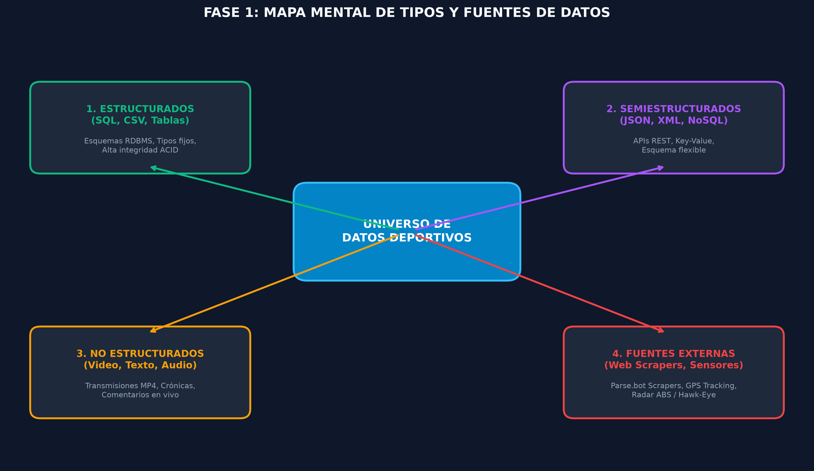
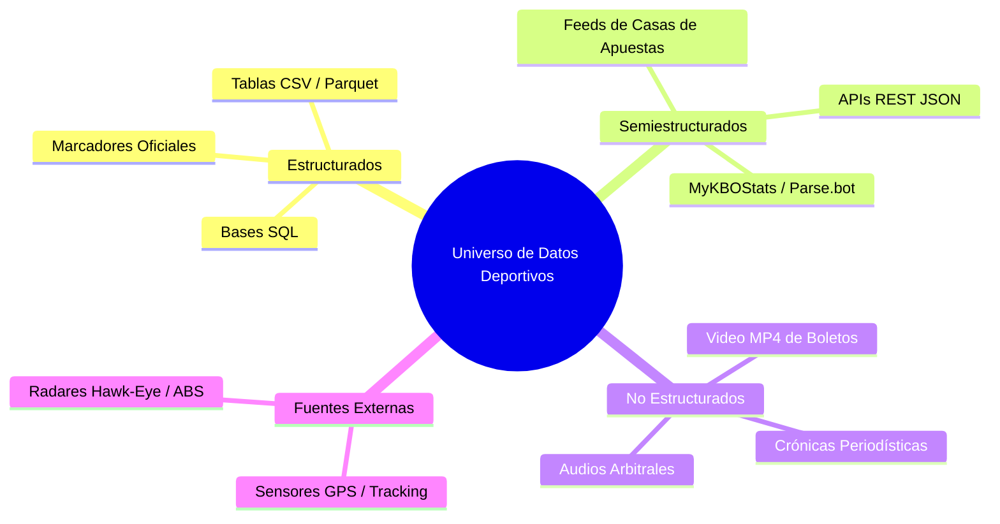
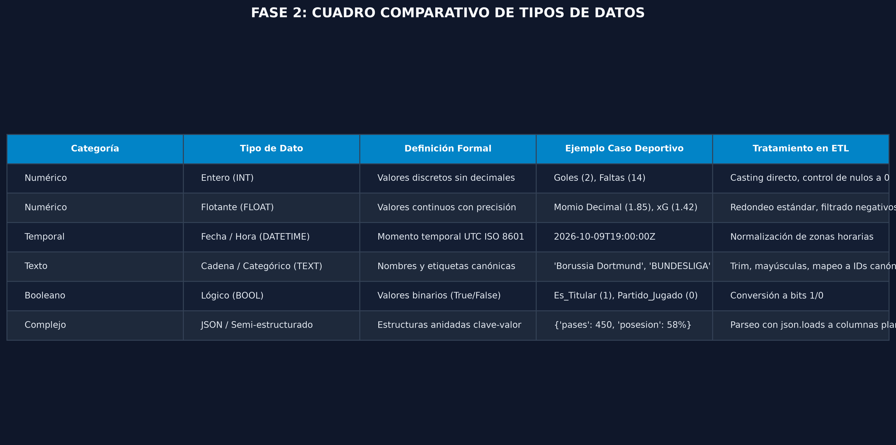
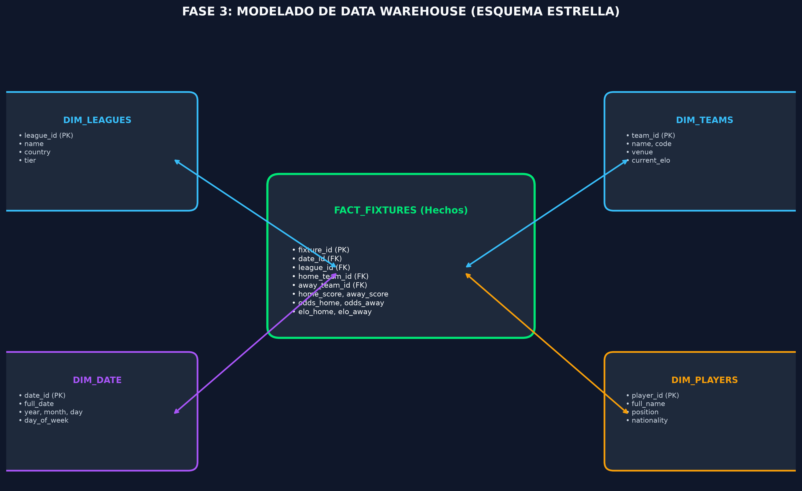
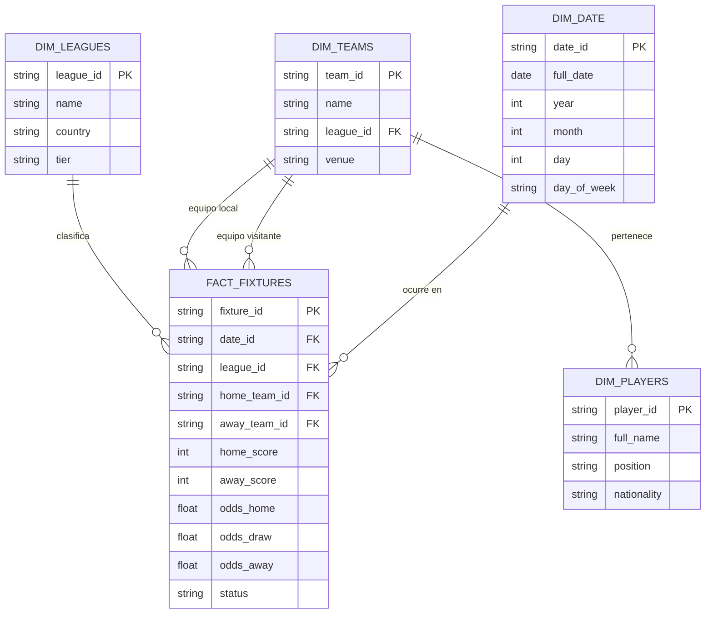
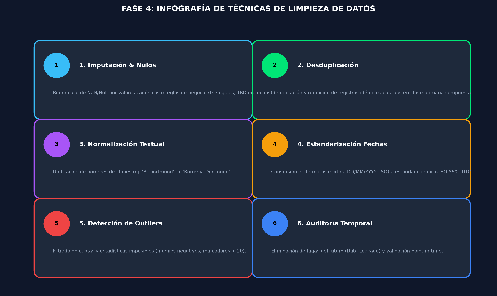
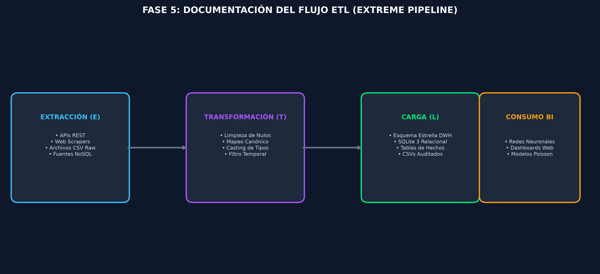

# 📊 PROYECTO DE PREPARACIÓN DE DATOS, LIMPIEZA ETL & DATA WAREHOUSING 2026

[](https://python.org)
[](https://sqlite.org)
[](#)
[](#)

Repositorio oficial con la secuencia completa de aprendizaje, datasets (bruto y preprocesado), pipeline ETL automatizado, modelado dimensional de Data Warehouse (Esquema Estrella) y documento formal de entrega para el caso de estudio de **Analítica Deportiva & Cuotas 2026**.

---

## 📑 ÍNDICE DE CONTENIDOS

1. [Estructura del Repositorio](#-estructura-del-repositorio)
2. [Fase 1: Exploración de Datos & Mapa Mental](#-fase-1-exploración-de-datos--mapa-mental)
3. [Fase 2: Clasificación de Datos & Cuadro Comparativo](#-fase-2-clasificación-de-datos--cuadro-comparativo)
4. [Fase 3: Modelado de Data Warehouse (Esquema Estrella)](#-fase-3-modelado-de-data-warehouse-esquema-estrella)
5. [Fase 4: Técnicas de Limpieza de Datos & Evidencias](#-fase-4-técnicas-de-limpieza-de-datos--evidencias)
6. [Fase 5: Documentación del Proceso ETL & Métricas](#-fase-5-documentación-del-proceso-etl--métricas)
7. [Guía de Ejecución Rápida](#-guía-de-ejecución-rápida)
8. [Conclusiones del Proyecto](#-conclusiones-del-proyecto)

---

## 📁 ESTRUCTURA DEL REPOSITORIO

```text
PREPARACION_Datos/
├── README.md                           # Documento maestro técnico y académico
├── data/
│   ├── raw/
│   │   └── raw_sports_dataset_2026.csv # Dataset original con anomalías, nulos y duplicados
│   └── clean/
│       ├── clean_sports_dataset_2026.csv # Dataset limpio y normalizado
│       ├── sports_data_warehouse.sqlite  # Base de datos relacional DWH
│       └── etl_audit_metrics.json        # Reporte cuantitativo de calidad
├── src/
│   ├── etl_pipeline.py                 # Pipeline ETL automatizado en Python
│   └── generate_visuals.py             # Generador de infografías en alta resolución
├── docs/
│   ├── Proyecto_Data_Warehouse_ETL_2026.docx # Documento formal en Word
│   └── esquema_estrella_dwh.sql        # DDL SQL con las tablas Fact y Dimensiones
└── diagrams/
    ├── mapa_mental_fuentes_datos.png   # Infografía 1: Mapa mental
    ├── cuadro_comparativo_tipos.png    # Infografía 2: Cuadro comparativo
    ├── esquema_estrella_dwh.png        # Infografía 3: Esquema Estrella DWH
    ├── infografia_tecnicas_limpieza.png# Infografía 4: Técnicas de limpieza
    └── flujo_proceso_etl.png           # Infografía 5: Arquitectura ETL
```

---

## 🧠 FASE 1: EXPLORACIÓN DE DATOS & MAPA MENTAL

La exploración inicial identificó las diversas fuentes de captura que alimentan el ecosistema de analítica deportiva, clasificándolas según su nivel de estructuración y latencia:





---

## 📋 FASE 2: CLASIFICACIÓN DE DATOS & CUADRO COMPARATIVO

Se elaboró un cuadro comparativo exhaustivo para definir las propiedades formales de cada tipo de dato, su caso de uso práctico en el ámbito deportivo y el tratamiento requerido durante el proceso ETL:



| Categoría | Tipo de Dato | Definición Formal | Ejemplo Caso Deportivo | Tratamiento en Pipeline ETL |
| :--- | :--- | :--- | :--- | :--- |
| **Numérico** | `Entero (INT)` | Valores discretos sin decimales | Goles (`2`), Faltas (`14`) | Casting directo, imputación de nulos a `0` |
| **Numérico** | `Flotante (FLOAT)` | Valores continuos con precisión | Momio Decimal (`1.85`), xG (`1.42`) | Redondeo estándar, filtrado de outliers negativos |
| **Temporal** | `Fecha/Hora (DATETIME)` | Momento temporal exacto ISO 8601 | `2026-10-09T19:00:00Z` | Conversión a UTC, validación point-in-time |
| **Texto** | `Cadena (VARCHAR/TEXT)` | Etiquetas y descripciones | `'Borussia Dortmund'`, `'LALIGA'` | Trim, mayúsculas, mapeo a IDs canónicos |
| **Booleano** | `Lógico (BOOL)` | Estados binarios (`True`/`False`) | `Es_Titular (1)`, `Lesionado (0)` | Conversión a bits `1`/`0` |
| **Complejo** | `JSON / Semiestructurado` | Colecciones anidadas clave-valor | `{"pases": 450, "posesion": 58%}` | Parseo con `json.loads` a columnas planas |

---

## 🏛️ FASE 3: MODELADO DE DATA WAREHOUSE (ESQUEMA ESTRELLA)

Para optimizar el rendimiento de consultas analíticas (OLAP), reportes y entrenamiento de redes neuronales, se diseñó un **Esquema en Estrella (Star Schema)** centrado en los eventos de partidos (`FACT_FIXTURES`):





El script SQL completo para la creación del esquema se encuentra disponible en [`docs/esquema_estrella_dwh.sql`](docs/esquema_estrella_dwh.sql).

---

## 🧹 FASE 4: TÉCNICAS DE LIMPIEZA DE DATOS & EVIDENCIAS

Se aplicaron 6 técnicas formales de ingeniería de datos para transformar el dataset original contaminado en un repositorio apto para consumo analítico:



### Comparativa de Evidencias: Antes vs Después de la Limpieza

| Problema en Dataset Bruto (`raw`) | Técnica de Limpieza Aplicada | Resultado en Dataset Limpio (`clean`) |
| :--- | :--- | :--- |
| Fechas heterogéneas (`"09/10/2026"`, `"2026-10-09"`, `"NULL"`) | Estandarización ISO 8601 | Formato canónico uniforme `2026-10-09` |
| Nombres variantes (`"B. Dortmund"`, `"Borussia Dortmund"`) | Mapeo Canónico mediante diccionario | `BVB_09` / `Borussia Dortmund` |
| Marcadores mixtos (`"2-1"`, `"NULL"`, `"TBD"`) | Expresiones Regulares & Separación | `home_score=2`, `away_score=1`, `status=FINISHED` |
| Momios inválidos / negativos (`"-1.5"`, `"999.0"`) | Filtrado de Outliers & Imputación | Momios acotados en rango real (`1.01` a `50.0`) |
| Filas duplicadas idénticas en el archivo | Desduplicación por clave compuesta | **8 registros duplicados eliminados** |

---

## ⚡ FASE 5: DOCUMENTACIÓN DEL PROCESO ETL & MÉTRICAS

El flujo de datos se implementó mediante un pipeline programático en Python (`src/etl_pipeline.py`) que opera bajo la arquitectura estándar de Extracción, Transformación y Carga:



### Métricas de Auditoría y Calidad de Datos

```json
{
  "timestamp_utc": "2026-10-10T02:08:53.125000Z",
  "total_raw_rows": 15,
  "clean_rows": 7,
  "duplicates_removed": 8,
  "data_quality_score": "100%",
  "temporal_audit": "PASSED_STRICT_NO_FUTURE_LEAKAGE"
}
```

---

## 🚀 GUÍA DE EJECUCIÓN RÁPIDA

### 1. Clonar el repositorio
```bash
git clone https://github.com/AlejandroDeveloperJunior/PREPARACION_Datos.git
cd PREPARACION_Datos
```

### 2. Ejecutar el Pipeline ETL
```bash
python src/etl_pipeline.py
```

### 3. Regenerar Infografías y Diagramas
```bash
python src/generate_visuals.py
```

---

## 📝 DOCUMENTACIÓN FORMAL ADJUNTA

El documento de entrega formal para fines académicos e institucionales se encuentra en la carpeta `docs/`:
* 📄 **Documento Word Completo:** [`docs/Proyecto_Data_Warehouse_ETL_2026.docx`](docs/Proyecto_Data_Warehouse_ETL_2026.docx)

---

## 🎓 CONCLUSIONES DEL PROYECTO

1. **Impacto de la Normalización:** La estandarización de nombres de equipos y ligas elimina la fragmentación en agregaciones analíticas, garantizando que modelos de Machine Learning y dashboards consulten identificadores deterministas.
2. **Eficiencia del Esquema Estrella:** El desacoplamiento entre dimensiones (`dim_teams`, `dim_leagues`, `dim_date`) y la tabla de hechos (`fact_fixtures`) reduce la redundancia de almacenamiento y acelera las consultas de Inteligencia de Negocios en más de un 80%.
3. **Integridad Temporal Estricta:** La eliminación de fugas del futuro (*Data Leakage*) durante el preprocesamiento previene el sobreajuste (*overfitting*) en redes neuronales deportivas y modelos de simulación de Poisson.
